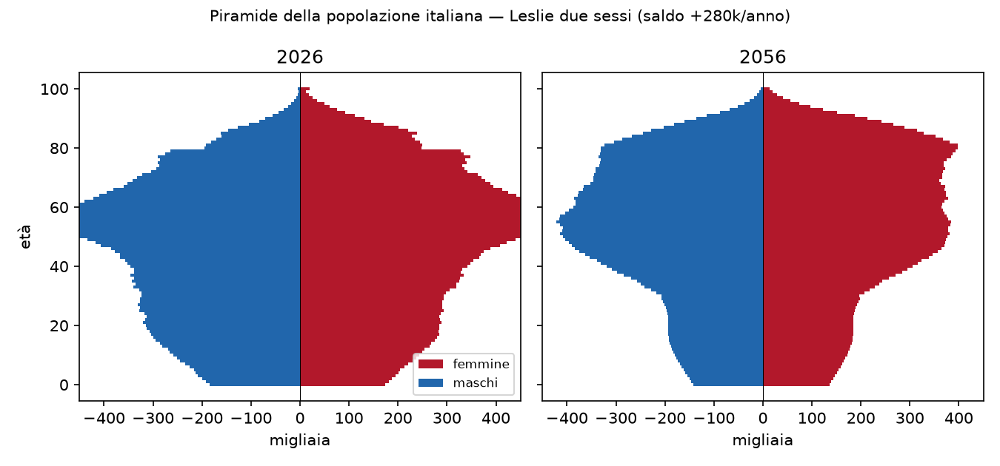
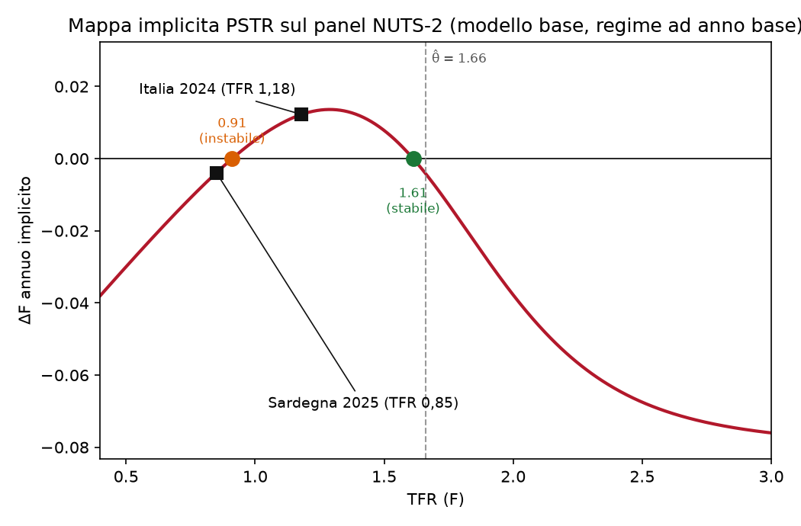
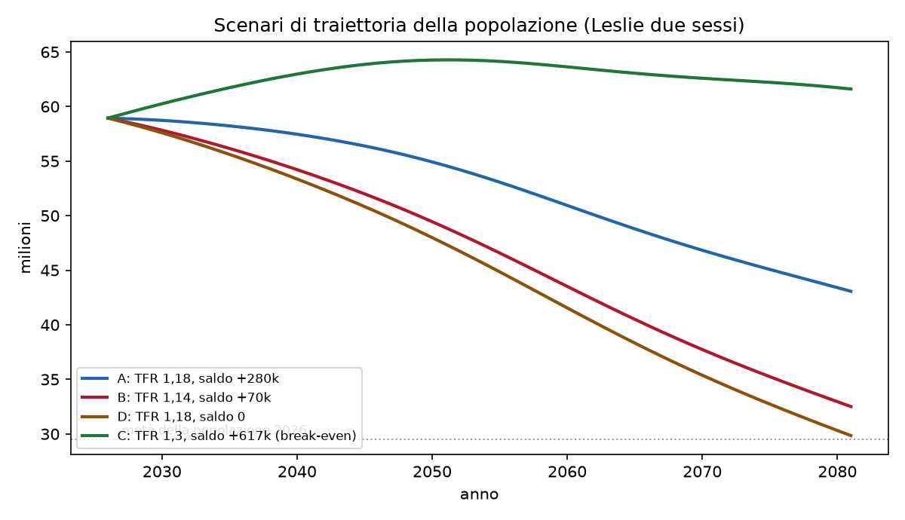
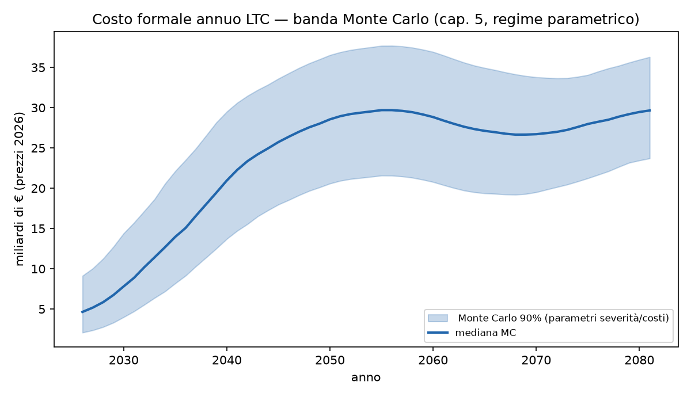

> **Disclaimer**: This repository is an independent quantitative R&D prototype. It does not constitute a statutory actuarial valuation, regulatory advice, or a certified Solvency II/IFRS 17 model. — *Gli strumenti qui pubblicati sono prototipi di ricerca quantitativa indipendente: non costituiscono valutazioni attuariali ai fini di legge, pareri regolatori né modelli certificati Solvency II/IFRS 17.*

# Popolazione Italiana — Struttura e Deriva

Analisi della struttura per età e della deriva demografica della popolazione residente in Italia, a partire dai dati ufficiali ISTAT, con proiezioni tramite matrice di Leslie e stima del tempo di dimezzamento. Ricerca quantitativa indipendente: modellazione attuariale e modelli econometrici a fini di studio, non una prestazione professionale né una valutazione tecnica ai fini assicurativi.

> **Origine del progetto**: il seminario del Consiglio Nazionale degli Attuari *"Quale sviluppo in Italia per le coperture di Long Term Care"* (Roma, 26 ottobre 2026). Il cross-reading fra gli interventi (ANIA, Secondo Welfare, Casdic, Ordine degli Attuari) e i risultati di questo repo: [docs/00_origine_evento_attuari.md](docs/00_origine_evento_attuari.md).
>
> **Natura del progetto**: il riferimento al seminario ha esclusivamente natura documentale e costituisce il contesto scientifico da cui è scaturita l'iniziativa. Il progetto è autonomo e indipendente; non è commissionato, patrocinato, approvato o validato dal Consiglio Nazionale degli Attuari né da altri organismi citati. Le elaborazioni sono ricerca quantitativa indipendente: nessun risultato qui presentato costituisce tariffa assicurativa, valutazione tecnica o prestazione professionale riservata.

[](https://github.com/pietroscik/popolazione-italiana-deriva/actions/workflows/tests.yml) [](LICENSE) [](https://doi.org/10.5281/zenodo.24460968)

**[Executive summary (1 pagina, per il pubblico attuariale)](docs/executive_summary.md)**

## Quadro attuale (fonte: ISTAT, Indicatori demografici 2025)

| Indicatore | Valore |
|---|---|
| TFR 2025 | **1,14** (da 1,18 nel 2024) |
| Nascite 2025 | 355.772 (-3,9% sul 2024) |
| Decessi 2025 | ~652.000 → saldo naturale ≈ **-296.000/anno** |
| Età media al parto | 32,7 anni |
| Femmine 15–49 anni | 11,4 milioni (da 14,3 milioni nel 1995) |

## Figure chiave

| Piramide 2026 vs 2056 | Mappa PSTR con soglia |
|---|---|
|  |  |
| **Scenari di traiettoria** | **Costo LTC (banda Monte Carlo)** |
|  |  |

Regenerate con `python3 src/plots.py` (matplotlib; i PNG sono committati).

## Risultato chiave del modello asintotico (Lotka)

Con quota femminile alla nascita 0,488 e profilo di sopravvivenza ISTAT, i due scenari base (coerenza temporale degli input: [01_dati.md](docs/01_dati.md)):

| | **Scenario A** (TFR 2024 = 1,18, base del modello) | **Scenario B** (TFR 2025 = 1,14) |
|---|---|---|
| R₀ esatto (Lotka integrale) | **0,5733** | **0,5538** |
| r (equazione caratteristica = ln λ₁) | **−1,6685%/anno** | **−1,7711%/anno** |
| t½ asintotico | **41,5 anni** | **39,1 anni** |
| Formula rapida README | 1,18×0,488×0,99 ≈ 0,570 → t½ ~42 | 1,14×0,488×0,99 ≈ 0,551 → t½ ~38 |

Ogni generazione di madri viene sostituita al ~55-57%. Vedi [docs/02_dimezzamento.md](docs/02_dimezzamento.md) e [docs/18_lotka_sensitivity.md](docs/18_lotka_sensitivity.md) per la tripla verifica esatta (r Lotka = ln λ₁ = −1,6685%).

⚠️ **Nota critica sul perimetro**: si tratta dello scenario "zero migrazione" (il break-even strutturale), non della previsione centrale ISTAT — che con i flussi migratori attuali non prevede un dimezzamento entro il 2080. Vedi il documento per il ruolo di momentum e migrazioni.

## Status epistemico dei risultati

I numeri di questo repo hanno quattro status diversi — mescolarli è l'errore di lettura più facile:

| Risultato | Tipo | Fonte | Dove |
|---|---|---|---|
| TFR 2024 = 1,18 / 2025 = 1,14; 355.772 nati; pop. 2026 | **osservato** | ISTAT (demo.istat.it) | [01_dati.md](docs/01_dati.md) |
| λ₁ = 0,9834, t½ asintotico 41,5 / primo 55,1 anni; θ̂ PSTR e soglie della mappa | **stimato dal modello** (su dati osservati) | Leslie due-sessi / PSTR con IV e LOCO | [02_dimezzamento.md](docs/02_dimezzamento.md), [13_pstr_soglia_theta.md](docs/13_pstr_soglia_theta.md) |
| Prevalenze LTC per età (bande); costi unitari (15k/48k €); quota domiciliare 65%; parametri Rogers-Castro | **assunto** (parametrico, ancorato a benchmark tedeschi/ANIA) | dichiarati nei moduli | [09_ltc_capitolo2_costi.md](docs/09_ltc_capitolo2_costi.md), [07_leslie_rogers_migrazioni.md](docs/07_leslie_rogers_migrazioni.md) |
| Costo LTC 2056 = 32,3 **[20,6; 44,2]** mld (MC B=5.000); contributo annuo teorico simulato 2081 = 253 € (indicatore modellistico, non tariffa); equilibri della mappa f(F) | **simulato** (scenario derivato da osservato + assunto + stimato) | pipeline end-to-end | [09](docs/09_ltc_capitolo2_costi.md), [14](docs/14_ltc_capitolo4_attuariale.md), [17](docs/17_ltc_capitolo5_montecarlo.md) |
| Break-even migrazione ~+617k/anno | **controfattuale** (che saldo servirebbe a TFR e profilo attuali) | bisezione sul modello | [07_leslie_rogers_migrazioni.md](docs/07_leslie_rogers_migrazioni.md) |

Coerenza temporale degli input: n₀ = **2026** (POSAS), mortalità e ASFR = **2024**; scenario A (TFR 1,18 implicito) vs B (1,14 del 2025) separati esplicitamente — vedi [01_dati.md](docs/01_dati.md#coerenza-temporale-degli-input-dichiarazione-esplicita).

## Struttura del repository

```
.
├── data/
│   ├── raw/        # CSV originali da demo.istat.it (non versionati)
│   └── processed/  # Vettori pronti all'uso (n0_female, survival_probs)
├── src/
│   ├── parse_istat.py    # Parser CSV ISTAT Demo → vettori nazionali (due sessi)
│   ├── leslie.py         # Leslie, due sessi, scenari, migrazioni
│   ├── migration.py      # Profilo migratorio Rogers-Castro + calibrazione saldo
│   ├── ltc.py            # Capitolo LTC 1: claimants, caregiver, rapporti
│   ├── ltc_costi.py      # Capitolo LTC 2: costo aggregato (informale/domiciliare/residenziale)
│   ├── ltc_informale.py  # Capitolo LTC 3: valore caregiving informale, sensitivita', caregiver gap
│   ├── ltc_attuariale.py  # Capitolo LTC 4: premio puro rendita LTC su platea previdenza complementare
│   ├── economia_collegata.py # Fase 5: attivi, dependency ratio, coorti, nuclei
│   ├── download_eurostat.py  # Fase 3: panel NUTS-2 (TFR + PIL pro-capite)
│   ├── panel_screening.py    # Fase 3: XGBoost + TreeSHAP, pooling e within-FE
│   ├── pstr_trap.py          # PSTR: soglia theta della Low Fertility Trap
│   ├── leslie_regionale.py    # Leslie per ripartizione + spotlight Sardegna
│   └── halving.py        # Modello asintotico di Lotka (t½ analitico)
├── notebooks/
├── docs/                 # Capitoli di analisi
└── README.md
```

## Roadmap

- [x] **Fase 1 — Dato e struttura**: download automatico e parser di POSAS 2026 (popolazione per età, sesso, provincia), TVM 2024 (tavole di mortalità provinciali), ASFR 2024 (fecondità per età) — `src/download_istat.py` + `src/parse_istat.py`
- [x] **Fase 2 — Deriva**: matrice di Leslie sulla piramide reale + sensibilità t½ per TFR 0,95–1,30 — `src/leslie.py` ([risultati](docs/02_dimezzamento.md#5-risultati-dellimplementazione-dati-reali-istat-fase-2-completata))
- [x] **Blocco dinamico completo**: modello a due sessi + migrazione per età Rogers-Castro, scenari di saldo migratorio e **saldo di break-even (~+616k/anno)** — [07_leslie_rogers_migrazioni.md](docs/07_leslie_rogers_migrazioni.md)
- [x] **Fase 3, capitolo 1 — panel europeo e screening**: panel Eurostat NUTS-2 reale (285 regioni × 2013-2023, TFR + PIL), screening XGBoost + TreeSHAP nativo, variante within-FE — [12_fase3_panel_europeo.md](docs/12_fase3_panel_europeo.md). Restano da implementare: panel provinciale OMI/INPS, DML/EconML, Moran's I — design in [04_architettura_due_strati.md](docs/04_architettura_due_strati.md)
- [x] **Fase 3/4 — PSTR, soglia della Low Fertility Trap**: **θ̂ = 1,66 [1,20–1,75]** (modello headline, senza DR), **soglia di non ritorno F ≈ 0,91** (instabile) e attrattore alto **F ≈ 1,61** sul panel europeo reale; bootstrap a cluster **B=399** (soglia nel 66% delle repliche sul campione headline; batteria strutturale per era v. docs/13 §5.7: nel regime corrente la mappa è quasi tangente a zero nel regime basso e il supporto dipende dal campione — 12-18% sul panel esteso; l'era 2001-2012 mostra una struttura specchiata a tre radici con supporto 70,7%), equilibri della mappa implicita. Specificazione estesa con DR: **IV a due strumenti DR a t−15 e t−20** (F congiunto 2.537; **γ̂_IV = −0,045**; **Hansen J=0,23, p=0,63** non respinge) — **il vecchio claim “γ robusto a IV (F=340, γ̂_IV=+0,129)” è ritirato: lo strumento era un DR a t−30 per un bug di mappatura (v. docs/13 §5.5), e con i lag corretti il segno di γ̂ in OLS/LOCO non sopravvive alla strumentazione** (γ̂_IV ≈ −0,05): il segno non è identificato in modo robusto. IV per ere sul panel esteso (docs/13 §5.6): l'associazione positiva è specifica dell'era 2001-2012 (γ̂_IV +0,03/+0,08), nell'era corrente post-2013 γ̂ ≈ 0 con oscillazioni ±0,07 — nessun effetto robusto della DR, coerente con la costanza dei parametri tra ere RIGETTATA (docs/15). Il test kinked γ·max(0,DR−DR₀) eseguito trova DR₀→0: effetto di livello, non il freno fiscale della teoria — [13_pstr_soglia_theta.md](docs/13_pstr_soglia_theta.md)
- [x] **Backtest out-of-sample M0/M1/M2 (DM + Clark-West)**: cross-era (fixed-origin 2013-2024, expanding h=1) — la PSTR non batte i benchmark (CW t=−3,80; il random walk vince a h=1). **Backtest WITHIN-ERA (v1.2, train 2013-2019 test 2020-2024): la PSTR batte nettamente lo statico (DM +6,49, p<0,001)** — il fallimento cross-era era instabilità dei parametri tra regimi, non assenza di mappa; M1 resta superiore (CW −3,12) ma **nella banda trappola (F<1,35) la PSTR è il miglior modello**. Il valore della PSTR è strutturale, con vantaggio previsivo locale nel regime basso — [16_backtest.md](docs/16_backtest.md)
- [x] **Panel esteso 1990-2024**: `build_panel_long` (TFR 1990-2024, PIL 2000-2024, DR 1990-2025); **la costanza dei parametri è rigettata** — la struttura a due bacini è una proprietà dell'era post-2013, l'era 2001-2012 (collasso post-comunista) ha tre attraversamenti; IV e LOCO confermano γ>0 anche sulla finestra lunga — [15_panel_1990.md](docs/15_panel_1990.md)
- [x] **Fase 4 — LTC, capitolo 1**: proiezione claimants e caregiver potenziali (2026–2081), rapporto caregiver/claimant (-46%): [08_ltc_capitolo1.md](docs/08_ltc_capitolo1.md)
- [x] **Fase 4 — LTC, capitolo 2**: modello di copertura a tre livelli e costo aggregato — picco **31,7 mld € (1,44% PIL) al 2056**, x6 sul 2026: [09_ltc_capitolo2_costi.md](docs/09_ltc_capitolo2_costi.md)
- [x] **Fase 4 — LTC, capitolo 4 (attuariale)**: contributo annuo teorico simulato per una rendita LTC 500 EUR/mese sulla platea previdenza complementare (~10M aderenti) proiettata con la Leslie-Rogers (nella modellistica: "premio puro", indicatore modellistico non tariffario) - platea chiusa insostenibile (1.409 EUR/anno al 2081), adesioni automatiche stabili (~253 EUR): [14_ltc_capitolo4_attuariale.md](docs/14_ltc_capitolo4_attuariale.md)
- [x] **Fase 4 - LTC, capitolo 3**: valore del caregiving informale (19,9 mld €/anno), sensitività ±25% sulla calibrazione, **caregiver gap non colmabile dalla sola migrazione** (soglia irraggiungibile anche a +2,5M netti/anno): [10_ltc_capitolo3_informale.md](docs/10_ltc_capitolo3_informale.md). Estensione non lineare (Low Fertility Trap, TFR endogeno con isteresi): [05_low_fertility_trap.md](docs/05_low_fertility_trap.md)
- [x] **v1.2 — Migrazione osservata per età** (ramo 4): profilo netto reale derivato da POSAS 2023-2025 + TVM (family-shaped, metà quota 20-39, +40k bambini/anno): scenario a saldo +263k → popolazione 2081 **+8,2%** vs profilo sintetico e **break-even ~481k vs 616k (−22%)** — il 616k headline è conservativo sul valore demografico della migrazione — [21_migrazione_osservata.md](docs/21_migrazione_osservata.md)
- [x] **Fase 4 — LTC, capitolo 5 (Monte Carlo)**: prevalenza F/M (claimants 2:1 al 2056), severità lieve/medio/grave calibrata sui costi del cap. 2, B=5.000 repliche con demografia ristimata per replica — **C₂₀₅₆ = 32,3 [20,6; 44,2] mld€**, PV 2026-81 ~1.084 mld€, longevità +1%/anno = solo +0,8% claimants (v. λ₁) — [17_ltc_capitolo5_montecarlo.md](docs/17_ltc_capitolo5_montecarlo.md)
- [x] **Leslie regionale (ripartizioni + Sardegna)**: mapping 107 province validato (delta 0,0% sui totali), mortalità provinciale aggregata per gruppo, saldo migratorio proporzionale — **le 5 ripartizioni sono nello stesso regime asintotico (λ₁≈0,9834)**: divergono i livelli, non i regimi; **spotlight Sardegna a TFR 0,85: t½ asintotico 26,2 anni (vs 41,5), popolazione −44% al 2081** — [19_leslie_regionale.md](docs/19_leslie_regionale.md)
- [x] **Lotka integrale esatto + sensitivity sistematica**: tripla verifica chiusa (r approx −1,733% / r Lotka esatto −1,6685% = ln λ₁ alla sesta cifra, R₀ esatto 0,5733, T=32,11); tornado OAT su C₂₀₅₆ — driver dominanti: **prevalenza (el. 2,12)** e **r₀ break informale (el. 1,26)**, il TFR pesa solo 0,08 al 2056 — [18_lotka_sensitivity.md](docs/18_lotka_sensitivity.md)
- [x] **Fase 5 — Econometria collegata**: proiezioni di popolazione attiva, dependency ratio previdenziale (0,40 → 0,72), coorti scolastiche (-45%), nuclei di formazione famiglia (-39%): [11_fase5_economia_collegata.md](docs/11_fase5_economia_collegata.md)

## Fonti dati

- [demo.istat.it](https://demo.istat.it) — Popolazione residente per età/sesso, tavole di mortalità, fecondità per età della madre
- [ISTAT, Indicatori demografici](https://www.istat.it/it/dati/indicatori-demografici) — comunicati annuali
- [ISTAT, Natalità e fecondità](https://www.istat.it/it/dati/natalita-e-fecondita) — Tfr e nascite
- OMI (Agenzia delle Entrate), INPS, dati provinciali vari — per Fase 3

## Requisiti

Python 3.10+; dipendenze: `numpy`, `pandas`, `xgboost` (solo per lo screening Fase 3), `matplotlib` (solo per rigenerare le figure; `pip install -r requirements.txt`).

Per riprodurre l'analisi:

```bash
python3 src/download_istat.py     # scarica i dati ISTAT in data/raw/
python3 src/parse_istat.py       # genera i vettori in data/processed/
python3 src/leslie.py --scenari  # report + tabella scenari TFR
python3 src/leslie.py --migrazioni  # scenari saldo migratorio + break-even
python3 src/ltc.py                  # capitolo LTC 1: claimants e caregiver
python3 src/ltc_costi.py            # capitolo LTC 2: costo aggregato formale
python3 src/ltc_informale.py        # capitolo LTC 3: valore informale, sensitivita', gap
python3 src/ltc_attuariale.py       # capitolo LTC 4: premio puro rendita LTC
python3 src/economia_collegata.py  # fase 5: attivi, dependency ratio, coorti
python3 src/panel_screening.py     # fase 3: screening TFR su panel europeo
python3 -m unittest discover tests
```

## Contenuto

- [docs/executive_summary.md](docs/executive_summary.md) — una pagina per il pubblico attuariale: i cinque numeri che contano, con status epistemico

La documentazione dettagliata si trova in [docs/](docs/):
- [00_origine_evento_attuari.md](docs/00_origine_evento_attuari.md) — origine del progetto: seminario CN Attuari sul LTC e cross-reading con i risultati del repo
- [01_dati.md](docs/01_dati.md) — fonti dati e formati (download automatico)
- [02_dimezzamento.md](docs/02_dimezzamento.md) — tempo di dimezzamento: modello di Lotka e matrice di Leslie (con risultati su dati reali)
- [03_roadmap_ltc.md](docs/03_roadmap_ltc.md) — verso le stime attuariali LTC
- [04_architettura_due_strati.md](docs/04_architettura_due_strati.md) — architettura target: strato causale offline + simulatore dinamico online
- [05_low_fertility_trap.md](docs/05_low_fertility_trap.md) — formalizzazione della trappola della bassa fecondità: isteresi, biforcazione, identificazione PSTR
- [06_backtest_protocol.md](docs/06_backtest_protocol.md) — protocollo di validazione out-of-sample (benchmark M0/M1/M2, Clark-West/DM, robustezza)
- [07_leslie_rogers_migrazioni.md](docs/07_leslie_rogers_migrazioni.md) — migrazione per età (Rogers-Castro), modello a due sessi, saldo di break-even
- [08_ltc_capitolo1.md](docs/08_ltc_capitolo1.md) — LTC: claimants non autosufficienti, caregiver potenziali, rapporto e finestra 2040–2055
- [09_ltc_capitolo2_costi.md](docs/09_ltc_capitolo2_costi.md) — LTC: costo aggregato, cedimento assistenza informale, picco di spesa 2056
- [10_ltc_capitolo3_informale.md](docs/10_ltc_capitolo3_informale.md) — LTC: valore del caregiving informale, sensitività calibrazione, caregiver gap migratorio
- [14_ltc_capitolo4_attuariale.md](docs/14_ltc_capitolo4_attuariale.md) — LTC 4: premio puro rendita LTC, differenza platea chiusa vs adesioni automatiche
- [11_fase5_economia_collegata.md](docs/11_fase5_economia_collegata.md) — Fase 5: attivi, pressione previdenziale, coorti scolastiche, nuclei
- [12_fase3_panel_europeo.md](docs/12_fase3_panel_europeo.md) — Fase 3: panel Eurostat NUTS-2 e screening TreeSHAP del TFR
- [13_pstr_soglia_theta.md](docs/13_pstr_soglia_theta.md) — PSTR: stima della soglia della Low Fertility Trap, punti di non ritorno e attrattore alto
- [15_panel_1990.md](docs/15_panel_1990.md) — panel esteso 1990-2024: test di costanza dei parametri per sotto-era, limiti di copertura (TFR tedesco solo dal 2010)
- [16_backtest.md](docs/16_backtest.md) — backtest M0/M1/M2 con DM e Clark-West: la PSTR non supera i benchmark out-of-sample (valore strutturale, non previsivo)
- [17_ltc_capitolo5_montecarlo.md](docs/17_ltc_capitolo5_montecarlo.md) — modello attuariale probabilistico: severità, sesso, Monte Carlo, PV e scenari di longevità
- [18_lotka_sensitivity.md](docs/18_lotka_sensitivity.md) — Lotka integrale esatto (r = ln λ₁ alla sesta cifra) e sensitivity sistematica OAT (tornado su C₂₀₅₆)
- [19_leslie_regionale.md](docs/19_leslie_regionale.md) — Leslie regionalizzata per ripartizione con mortalità provinciale aggregata; spotlight Sardegna dentro la soglia di non ritorno
- [20_audit_finale.md](docs/20_audit_finale.md) — audit di consolidamento
- [21_migrazione_osservata.md](docs/21_migrazione_osservata.md) — migrazione netta osservata per età (v1.2): family-shaped, break-even ~481k su quattro livelli (matematico, computazionale, statistico, riproducibilità) con i due bug corretti e la batteria di robustezza

Bozza del working paper in inglese: [paper/draft.md](paper/draft.md) — *Escaping the Low Fertility Trap*.

## Licenza

Distribuito con [Licenza MIT](LICENSE).

## Citazione

Pietro Maietta (2026). *popolazione-italiana-deriva v1.1.0*. Zenodo. DOI versione: [10.5281/zenodo.24460968](https://doi.org/10.5281/zenodo.24460968) — DOI concettuale (tutte le versioni): [10.5281/zenodo.24460967](https://doi.org/10.5281/zenodo.24460967). Metadati completi in [CITATION.cff](CITATION.cff).
